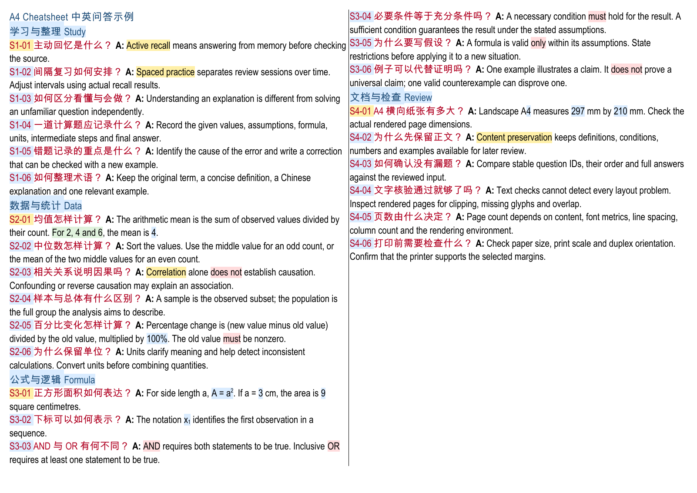

# A4 Cheatsheet Skill

把课程笔记整理成可编辑的 A4 多栏 Word 速查表：中文问题、英文关键词、彩色重点，以及逐题内容核验。

由 [rwang181-oss](https://github.com/rwang181-oss) 整理与分享。适合希望复用排版流程的同学，也适合想研究文档类 AI Skill 的开发者。

**[下载 Skill ZIP](https://github.com/rwang181-oss/a4-cheatsheet-skill/releases/latest/download/artifact-template-a4-cheatsheet.zip)** · **[查看版本说明](https://github.com/rwang181-oss/a4-cheatsheet-skill/releases/latest)**



## 能做什么

- 输出可编辑 `.docx`，默认目标为一张 A4 双面、横向两页；用户可以指定其他页数。
- 中文问题与英文关键词并存，深红问题标题、深蓝章节标题，数字和重点用浅色高亮。
- 按内容调整栏数、字号和行距，优先完整保留问答正文。
- 支持简单公式上下标和原生 Word 数学结构（复杂公式需文档工具配合）。
- 附带生成、逐题核验、标题样式修复三个 Python 脚本。

这是供 AI 助手使用的 **Skill**，需要支持本地技能和文件执行的环境。它不是独立桌面应用，也不包含课程题库或自动保证正确的答案。

## 安装到 Codex

### 方法一：让 Codex 安装

把下面这段话发给支持 Skill Installer 的 Codex：

```text
使用 $skill-installer 安装这个仓库里的 skill：
https://github.com/rwang181-oss/a4-cheatsheet-skill/tree/main/skills/artifact-template-a4-cheatsheet
```

### 方法二：下载后手动放入技能目录

1. 下载上面的 Skill ZIP 并解压。
2. 将完整的 `artifact-template-a4-cheatsheet` 文件夹放到用户目录下的 `.agents/skills/`；也可放在当前项目的 `.agents/skills/`。
3. 确认路径形如 `~/.agents/skills/artifact-template-a4-cheatsheet/SKILL.md`，不要多套一层文件夹。Windows 用户目录通常是 `C:\Users\你的用户名`。
4. 回到 Codex 查看技能列表；未出现时重启 Codex。已经装过同名技能时，先保留自己的修改，再决定替换哪一份。

安装位置与调用方式见 [OpenAI 官方技能文档](https://learn.chatgpt.com/docs/build-skills)。本仓库采用独立 Skill 目录发布，尚未上架插件目录。

## 开始使用

提供你有权使用的课程材料或已经整理好的问答，再发送：

```text
使用 $artifact-template-a4-cheatsheet，把我提供的材料整理成横向 A4 Word 速查表。
目标为两页，保留中文问题、英文关键词和完整问答。
请先核对来源和题目，再调整排版，渲染后逐页检查。
如果内容放不下，请说明冲突，不要直接删除正文。
```

原技能的完整文档流程依赖 **Documents 文档技能与可用的 DOCX 渲染环境**，这些不随本仓库打包。只有 Python 时可以运行下面的生成与结构核验脚本；这不代表已经检查实际分页和视觉效果。

## 本地运行示例

需要 Python 3.10 或以上。在仓库根目录执行；按系统配置将 `python` 替换为 `python3` 或 `py`。建议使用独立虚拟环境。

```bash
python -m pip install -r skills/artifact-template-a4-cheatsheet/requirements.txt
python skills/artifact-template-a4-cheatsheet/scripts/build_cheatsheet.py skills/artifact-template-a4-cheatsheet/examples/sample.json --output build/sample.docx --font 12 --line 16 --columns 2
python skills/artifact-template-a4-cheatsheet/scripts/check_cheatsheet.py skills/artifact-template-a4-cheatsheet/examples/sample.json build/sample.docx
```

用 Word 打开，或通过 Documents 工具渲染。将实际渲染出的 PDF 交给核验脚本，可增加页数和全文检查：

```bash
python skills/artifact-template-a4-cheatsheet/scripts/check_cheatsheet.py skills/artifact-template-a4-cheatsheet/examples/sample.json build/sample.docx --pdf build/sample.pdf --expected-pages 1
```

公开示例有 24 道通用问答，使用 2 栏、12 pt 字体，目标为一页，用来演示样式与脚本。它不是默认两页密集成品的容量承诺。生成器拒绝覆盖已有文件；仅在确认要替换时使用 `--overwrite`。

## 排版与使用边界

- 默认字体为 Arial Narrow 和 Arial Unicode MS；字体未安装时可能替换，必须重新检查中文、公式和分页。本仓库不分发字体。
- 3.5 pt 是密集排版参考值，阅读难度较高；内容少时应增大字号。无法保证任意材料都完整放进两页。
- 4 mm 边距可能超出部分打印机的可打印范围。打印前检查预览，通常使用 100% 比例、横向双面、短边翻转。
- 完整性核验以已审核的 JSON 输入为准，不会自动证明材料整理正确、来源齐全或考试覆盖充分。
- 用于复习整理；带入考试前请遵守课程对参考资料的规定。
- 当前版本已验证本地生成与渲染示例；未对所有操作系统、Word 版本或其他 AI 客户端作兼容性承诺。

## 文件说明

| 文件 | 用途 |
| --- | --- |
| `skills/artifact-template-a4-cheatsheet/SKILL.md` | AI 助手执行规则 |
| `scripts/build_cheatsheet.py` | 从审核后的 JSON 生成 Word |
| `scripts/check_cheatsheet.py` | 核验题目、正文、样式和可选 PDF |
| `scripts/restyle_titles.py` | 原位修复标题颜色和字重 |
| `examples/sample.json` | 通用示例输入 |
| `assets/reference.docx` | 通用样式参考 |
| `references/` | 输入格式、排版和核验说明 |

表中短路径均相对于技能目录。公开版只保留通用示例，不包含个人课程原件、录音稿或私人学习记录。

发现问题或希望改进示例，欢迎在 [Issues](https://github.com/rwang181-oss/a4-cheatsheet-skill/issues) 反馈，并附上可公开的最小复现材料。
